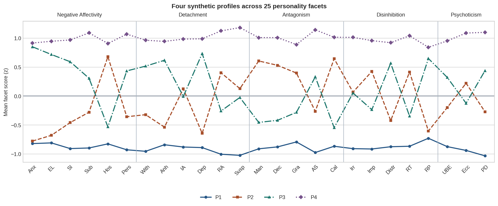

# Latent profiles of personality traits

A reproducible demonstration of how Gaussian mixture models summarize 25 synthetic continuous scores named after PID-5 facets. The project compares two and four profiles to show the difference between **overall trait elevation** and **the relative shape of a profile**.

**All data are completely synthetic.** The simulation was deliberately designed with four underlying components for teaching. Every table and figure comes from fictional scores generated with a fixed seed and hand-designed parameters. Finding four components in this run illustrates the simulation design and provides no empirical evidence about personality profiles.

## What the models show

Latent profile analysis uses a mixture of distributions to describe patterns in continuous indicators. Here each component has a mean and variance for every facet, and the model estimates each observation's probability of belonging to each component. The diagonal covariance specification assumes independence between facets within a component. The plots group the 25 named facets under Negative Affectivity, Detachment, Antagonism, Disinhibition and Psychoticism for display. The grouping serves as a visual guide and does not implement a scoring key.

- **Two profiles** summarize a broad lower-to-higher elevation gradient. Overall elevation accounts for about 85% of the weighted variation between the fitted centroids.
- **Four profiles** retain the low and high profiles and reveal two intermediate patterns. Centering each profile makes the contrasts across and within domains clearer. All five runs agree on the maximum-posterior assignments for both two and four profiles.
- **Six profiles** illustrate the tradeoff between fit and stability. Relative to four, in-sample log-likelihood improves. The smallest group falls from 218 to 35 and the minimum pairwise adjusted Rand index across seeds falls from 1.00 to 0.75.

BIC balances in-sample fit and model complexity. Relative entropy measures certainty given the fitted model. Both AIC and BIC favor four in this run. Relative entropy is high for both two and four, even though they summarize different aspects of the scores. The notebook reads these results alongside group sizes, posterior probabilities and stability across seeds.

See the [analysis notebook](notebooks/latent_profile_analysis.ipynb) for the full comparison.



### How to read the profiles

Each line traces the 25 standardized facet means for a fitted profile. Zero marks the synthetic sample mean for each facet. Two profiles mainly summarize a lower-to-higher elevation gradient. Four distinguish two additional profiles with similar overall elevation and different shapes.

For example, P2 is relatively higher on Hostility and lower on Anxiousness, two facets displayed under Negative Affectivity. P3 shows the reverse contrast. Within Antagonism, P2 is relatively higher on Callousness and lower on Attention Seeking, while P3 reverses that pattern. The simulation uses four components with deliberately specified facet contrasts for teaching. These patterns provide no empirical evidence about personality.

| Supporting figure | What to look for |
|---|---|
| [Fit and stability](figures/fit-and-stability.png) | AIC, BIC and seed-to-seed agreement for the candidate counts |
| [Elevation and shape](figures/profile-elevation-and-shape.png) | Standardized and centered centroids for two and four profiles |
| [Profile sizes](figures/profile-sizes.png) | Modal group proportions and estimated mixture weights |

## Run the project

Use Python 3.12. From the repository root, create a virtual environment and install the dependencies.

```bash
python -m venv .venv
source .venv/bin/activate
python -m pip install -r requirements.txt
jupyter lab notebooks/latent_profile_analysis.ipynb
```

On Windows, activate with `.venv\Scripts\Activate.ps1` in PowerShell. Select the Python kernel for that environment and use **Restart Kernel and Run All Cells**. The notebook generates the synthetic data in memory and regenerates the four PNG files in `figures/`.

For a headless run from the repository root:

```bash
python -m nbconvert --to notebook --execute --inplace notebooks/latent_profile_analysis.ipynb
```

The stack uses NumPy, pandas, SciPy, scikit-learn, Matplotlib and Jupyter. The implementation lives in `src/simulation.py`, `src/modeling.py` and `src/visualization.py`.

## Limitations

The generator deliberately builds in four components and a clear shape contrast. Agreement across seeds measures optimization stability on one simulated sample. Generalization and stability across samples require separate evaluation. In empirical data, skew, residual correlations, measurement error and sampling can all affect apparent profiles. The components here illustrate modeling choices and have no diagnostic meaning.
